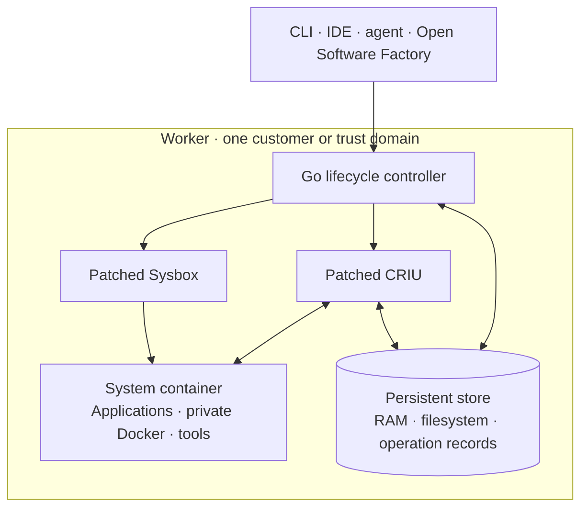

# Factorybox

[](https://github.com/maxcodefaster/factorybox/actions/workflows/ci.yaml)

Pause a development environment. Resume where its processes left off.

Factorybox is a Linux system-container runtime built on pinned, patched
[Sysbox](https://github.com/nestybox/sysbox) and
[CRIU](https://criu.org/). It saves application memory and filesystem state,
restores independent forks, and manages pause, resume and recovery through a
Go lifecycle controller.

A development environment includes running tools, private Docker state and work
in progress. Factorybox preserves that state on infrastructure you operate.
Editors, Dev Containers and agents connect as consumers.

## What you can do

- **Checkpoint and fork.** Create an independent environment with its own memory
  and mutable filesystem, then branch it again.
- **Pause and resume.** Save the running state, release the sandbox's anonymous
  RAM and continue useful work from that state.
- **Recover a committed pause.** Replace a worker on the same host and recover
  using its intact persistent store and verified operation records.

## How it differs from Sysbox

Sysbox provides the system-container foundation. Factorybox adds the lifecycle
needed to preserve and branch a running environment.

| | Sysbox | Factorybox |
| --- | --- | --- |
| Focus | Run system software such as Docker and systemd inside containers | Save, branch, pause and restore complete environments |
| Components | Specialized OCI runtime, filesystem service and manager | Patched Sysbox, patched CRIU and a Go lifecycle controller |
| State management | Container execution | RAM/filesystem checkpoints, independent forks, durable operation records and guarded recovery |

We patch Sysbox's virtual filesystem and manager state, plus CRIU's namespace
and nested Docker/OverlayFS restore paths. The Go controller records operation
intent, completion and resource ownership. Component versions, source hashes
and ordered patches are pinned in the [source lock](upstream/lock.json).
[Patch and build details →](docs/build-and-release.md)

## Architecture



The worker runs as a privileged container on Linux and shares the host kernel.
It requires no KVM. Use separate workers per customer or trust domain.

[Open Software Factory](https://github.com/maxcodefaster/open-software-factory)
is the first consumer integration, covering shared project files, Dev Containers
and a small prepared pool. The runtime has no IDE or agent lifecycle dependency.

## Get started

With [mise](https://mise.jdx.dev/) installed, run the portable checks:

```sh
git clone https://github.com/maxcodefaster/factorybox.git
cd factorybox
mise trust
mise install
mise exec -- python3 tools/check.py
```

For native builds and operation, follow the [build guide](docs/build-and-release.md)
and [local worker example](examples/worker). Check the
[worker contract](docs/worker-contract.md) before choosing a host.

## Status

AMD64 and ARM64 use one codebase and the same release gates. The release-only
pipeline builds and tests each image on its matching Linux runner, then publishes
the combined image manifest only after both jobs pass. Each worker still admits
only its tested kernel, page size and local-storage profile.

The [current readiness checklist](docs/first-release-status.md) separates recent
Factory integration results, remaining release checks and historical failures.
Local integration passes do not qualify an untested release image. The 24-hour
endurance run and 100-run series are deferred from the first controlled release.
Cross-node migration and arbitrary hosts are outside that release's scope.

[Release scope](docs/releases/0.1.0-rc.1.md) ·
[Measurements](docs/first-release-performance.md) ·
[Factory integration](docs/factory-consumer.md) ·
[Kubernetes deployment contract](docs/kubernetes-worker.md)

## License

Original Factorybox code is [Apache-2.0](LICENSE).
Sysbox, CRIU and their dependencies retain their original licenses and notices.
See [LICENSING.md](LICENSING.md) for component and distribution terms.
