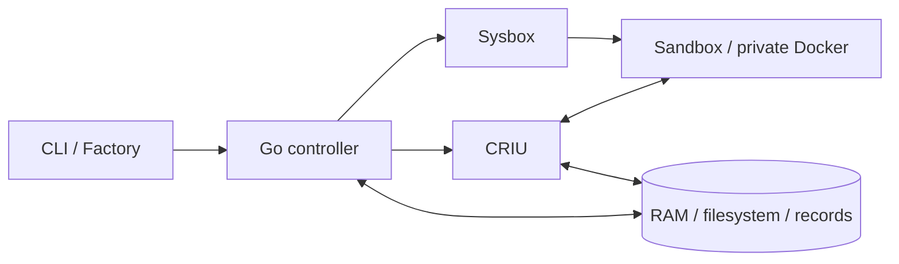

# Factorybox

A Linux runtime for development Sandboxes. Checkpoint a running environment, pause it to release
RAM, resume its processes, or fork an independent copy of its memory and filesystem.

Factorybox combines pinned [Sysbox](https://github.com/nestybox/sysbox) and [CRIU](https://criu.org)
with a Go lifecycle controller. Each Sandbox can run a private Docker daemon. No KVM or custom
kernel required. [Open Software Factory](https://github.com/maxcodefaster/open-software-factory)
uses it for coding agents and development environments.

## Why system containers

Development needs services, tools and Docker, often on nodes without hardware virtualization.
Sysbox provides that environment. Factorybox adds checkpoints, forks and recorded operations
so interrupted work can recover without guessing who owns its resources.

| | Containers | gVisor | MicroVMs | Factorybox |
| --- | --- | --- | --- | --- |
| Kernel | Shared | Userspace kernel | Separate guest kernel | Shared, user namespaces |
| Hardware virtualization | No | No | Required | No |
| Memory checkpoint | Additional tooling | Supported | Runtime-dependent | Built in |
| Node setup | Container runtime | Sandbox runtime | VMM and virtualization | Privileged worker Pod |

The worker is privileged and shares the node kernel. Keep each worker in one trust domain and
give mutually untrusted tenants separate nodes. Cross-node RAM migration is not supported.

## How it works



The controller records intent, completion and resource ownership. Pinned patches handle Sysbox's
virtual filesystem state and CRIU's nested Docker namespaces and OverlayFS restores.
[Source versions, hashes and patches](upstream/lock.json).

## Measured performance

Ten warm cycles measured **4.07 s median pause** and **2.99 s median resume to a healthy App**.
All ten preserved the process, memory and counters. The worker ran two Node containers and
256 MiB of random App memory, limited to 3 CPU / 3 GiB on a Ryzen 7 4800U node with k3s.
Times include Kubernetes transport; they are not cold-start times.
[Samples and method](https://github.com/maxcodefaster/open-software-factory/blob/main/assets/story/lifecycle.json).

## Install and check

Signed workers for Linux arm64 and amd64 are at
`ghcr.io/maxcodefaster/factorybox-worker:v0.1.0-beta.1`.
The [Factory chart](https://github.com/maxcodefaster/open-software-factory/blob/main/deploy/helm/factory/README.md)
pins the worker image and executable hash for each architecture and documents admission and recovery.

Portable source checks:

```sh
git clone https://github.com/maxcodefaster/factorybox.git
cd factorybox
mise trust && mise install
mise exec -- python3 tools/check.py
```

Native builds and checks use the Factory commands `factorybox:build`, `runtime:conformance`
and `factorybox:publish`. [AGENTS.md](AGENTS.md) holds contributor rules.

Report bugs in GitHub Issues and vulnerabilities through [SECURITY.md](SECURITY.md).
Original code is [Apache-2.0](LICENSE). Upstream components keep their own licenses;
see [LICENSING.md](LICENSING.md) and [NOTICE](NOTICE).
