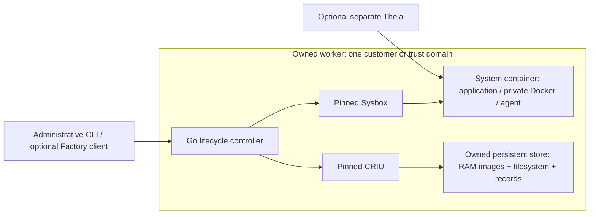

# Factorybox

Factorybox is a standalone Linux system-container runtime with complete RAM and
filesystem checkpoints, independent forks, pause and resume. It combines a Go
lifecycle controller with exactly pinned, patched Sysbox and CRIU components.
An IDE, Dev Container or agent can consume the runtime without becoming a
lifecycle dependency.

The local AMD64 pilot passed on 2026-10-22. The selected profile binds 44
evidence gates, reproducible binaries and twenty complete comparison runs.
Production qualification remains open. Start with the
[acceptance report](docs/pilot-validation.md) and
[supported worker contract](docs/worker-contract.md).

## What works

- Checkpoint a running sandbox and restore an independent RAM/filesystem fork.
- Checkpoint and fork an existing fork or a resumed source. A descendant remains
  useful after deleting its original source.
- Pause with measured release of source anonymous RAM and resident snapshot-RAM
  pages, then resume useful application work from the saved state.
- Recover a fully committed pause after planned or abrupt removal of the whole
  worker, using a fresh worker on the same host and the complete persistent store.
- Reject incomplete or corrupt recovery inputs and reconcile exact completed
  requests. Delete only objects whose saved ownership matches.

Both complete examples passed. The [minimal Dev Container](examples/minimal)
preserves application RAM and files. The [Factory composition](examples/factory)
adds private Docker, Compose, Dev Containers, a separate Theia IDE and real
OpenCode. Its active shell tool preserves private RAM and file watches across
fork/resume, produces different branch results and returns its real exit status
to the agent. The model peer is a deterministic local test server. External
model inference, provider reconnection and external side effects need pilot tests.
Theia remains a separate reconnecting consumer rather than part of sandbox RAM.



## Measured performance

Five observations per configuration and example, interleaved on one host.
Times are medians in seconds. A useful fork starts from an already published
checkpoint; creating a new checkpoint adds its own cost.

| Factory operation | Original v0.1, Docker VFS | Selected pilot, Docker Overlay2 |
| --- | ---: | ---: |
| Checkpoint | 24.158 | 6.875 |
| Useful fork | 18.044 | 5.995 |
| Pause | 24.165 | 7.593 |
| Useful resume | 8.613 | 2.834 |
| Fresh start with prepared inputs | 33.683 | 33.099 |
| Cold worker, local preparation and useful application | 58.152 | 55.581 |

The minimal example takes about 2.009 s for a useful fork, 1.870 s to pause and
1.045 s to resume. Its checkpoint after resume regressed from 1.783 s to
2.100 s, within the predeclared 20% allowance. These observations establish
neither p95 nor a stable sub-three-second service level.

The largest demonstrated change is private Docker's storage representation:
about 335 MB and 10,102 entries with Overlay2 instead of 1,362 MB and 31,475
entries with VFS. Ordered CRIU fixes make those nested layers restorable.
Every branch still has independent mutable backing. Removing a duplicate
source payload read gives about 3% in its isolated copy microbenchmark; the
combined lifecycle comparison does not isolate its contribution.

Pause leaves source anonymous memory and resident snapshot-RAM pages at zero.
Worker services, filesystem cache and metadata still consume memory. Full
observations, preparation costs, ranges, failures and memory measurements are
linked from the [acceptance report](docs/pilot-validation.md).

## How it compares

[Battleships](https://battleships.dev/) is a provider comparison and cost
estimator, rather than a sandbox runtime. Its catalogue is useful for finding
alternatives; a feature label or provider benchmark does not establish that
the same workload, memory, Docker state and recovery boundary were tested.

The following comparison uses each project's own documentation, checked on
2026-10-22. No provider was benchmarked against Factorybox here.

| Project | Role and documented capabilities | Difference from this pilot |
| --- | --- | --- |
| Factorybox | Self-managed system-container lifecycle with the complete admitted RAM/filesystem forks and committed-pause recovery above | Exact local AMD64 scope; administrative CLI; operator supplies workers and storage |
| [Sysbox](https://github.com/nestybox/sysbox) | A specialized runc for system containers running Docker, systemd and other system software | Factorybox builds on its isolation and virtualization, adding lifecycle records, complete independent snapshots, pause memory accounting and verified recovery |
| [Daytona](https://www.daytona.io/docs/en/persistence/) | Documents memory-preserving pause/resume, hot snapshots and independent forks for VM sandboxes; container sandboxes do not support pause | A managed sandbox platform with a different isolation and operations model; ordinary stop/start clears memory |
| [Modal](https://modal.com/docs/guide/sandbox-snapshots) | Documents filesystem snapshots and Alpha memory snapshots that capture memory plus filesystem into a new sandbox | Its published snapshot restrictions and managed service contract must be evaluated separately from this local runtime |

Sysbox and Factorybox share the host kernel. Neither this implementation nor
its tests establish VM isolation. Deploy separate workers per customer or
trust domain. Factorybox has its own CLI and versioned JSON contract; Sysbox
CLI/OCI feature parity and arbitrary Sysbox workload compatibility are not
promised. The tested Factory workload is the acceptance boundary.

### Where Kubernetes fits

[Kubernetes](https://kubernetes.io/docs/concepts/overview/) provides worker
placement, storage orchestration, rollouts and service management. Those are
useful reasons to integrate Factorybox into an existing cluster. They do not
make its checkpoint or resume faster, or supply application RAM recovery.

This repository qualifies a Docker worker and local persistent volume. It
does not yet qualify a Kubernetes operator, arbitrary Kubernetes nodes or a
PVC/storage backend. A future deployment must qualify the exact node kernel,
privileges, cgroups, storage and fencing. A paused sandbox would need its
complete owned store on that qualified storage, including filesystem backing,
RAM images and operation records. A pod restart or a movable PVC alone does
not establish restore on another node. Cross-node migration is outside this pilot.

## What changed in Sysbox and CRIU

The [source lock](upstream/lock.json) records archive hashes, ordered patches,
imported overlays, prepared-file hashes and fixture compatibility declarations.
The [pilot profile](upstream/amd64-pilot-profile.json) adds the selected CRIU
patches, actual binary identities and evidence hashes. No upstream version
floats at build time.

| Component | Pinned source commit |
| --- | --- |
| [Sysbox runc](https://github.com/nestybox/sysbox-runc) | `081856cc5d17e7095f066b08d0eca6bb0b515c47` |
| [Sysbox fs](https://github.com/nestybox/sysbox-fs) | `c3d2ebc65102e32e74e383675f03b45556326888` |
| [Sysbox mgr](https://github.com/nestybox/sysbox-mgr) | `2d45af01bcfd8641e6641f76104c6003bf501cd7` |
| [CRIU source fork](https://github.com/castai/criu) | `086df34a2da27125fa05e66ba4d6b63cbb220b2e` |

The lock also pins Sysbox ipc, libs, fuse and upstream tests. These are the
actual changes, rather than a claim that the components run unmodified:

- Sysbox patches and retained overlays capture/restore virtual filesystem
  state, preserve registration and namespace lifetime, reconstruct rootfs,
  seccomp listeners and cgroup delegation, and issue restore receipts.
  The manager can disable unqualified binfmt_misc handling. Restored overlays
  use a mount-local `index=off` setting.
- The base CRIU patch stack handles the admitted nested namespaces, detached
  proc roots/descriptors, time namespaces, cgroup-v2 limits and zombie PIDs.
  Five additional retained-context/exit-observer patches protect original
  source state during the evidenced capture failures. Three nested-overlay
  patches preserve layer mappings, stable paths and shared upper/work mounts.
- The Go runtime owns intent/completion records, component and object identity,
  filesystem admission/copy verification, memory release, recovery and deletion.
  Bounded inotify fallback roots are an explicit OCI annotation.

Each selected change has regression evidence. The immutable imported reference
and overlays retain their original bytes; later changes are ordered patches.
Candidate filenames are historical provenance, not automatic selection.
SHM, lazy/delta snapshots and read-hint experiments are excluded from the
selected path. [Investigation notes](docs/pilot-progress.md) retain the limits
and failed approaches.

## Build and integrate

Only the evidenced Linux AMD64 tuple is qualified for this pilot: kernel
`7.2.8-9-omarchy`, 4096-byte pages, cgroup v2 and the tested Docker/local-volume
path. `factorybox doctor` checks the tuple; it does not replace native tests.
Cross-compilation does not qualify another machine.

The repository pins Go and Python through mise. Run portable checks first:

```sh
mise exec -- python3 tools/check.py
mise exec -- python3 tools/sources.py prepare
mise exec -- python3 tools/sources.py verify
```

Build the native base and Sysbox, then the selected CRIU composition and worker:

```sh
mise exec -- python3 tools/build_native_base.py --platform linux/amd64
mise exec -- python3 tools/build_sysbox.py --platform linux/amd64 --network host --bounded-build
mise exec -- python3 tests/criu-retained-candidate/build.py \
  --native-base-build "$base_build" --exit-hold --exit-hold-socket \
  --nested-overlay --nested-overlay-stable-paths --nested-overlay-shared-root
mise exec -- python3 tools/build_worker.py \
  --native-base-build "$base_build" --sysbox-build "$sysbox_build" \
  --retained-candidate "$criu_build"
```

Set the variables to the exact successful artifact names printed by the
preceding builds. On the tested host the Docker tools use
`FACTORYBOX_DOCKER_CONTEXT=default FACTORYBOX_DOCKER_ELEVATION=sudo`.
These commands build local containers and install no host runtime.
Independent offline rebuilds reproduced all three Sysbox executables, CRIU,
the complete worker package and image. They reuse verified toolchains and
dependency inputs; future network/package availability is a separate concern.

Use the [worker integration example](examples/worker/README.md) for the exact
Compose deployment, store ownership, readiness and administrative workflow.
The worker needs privileged container access and owns one persistent store.
It exposes no network API. The tested worker ceiling is 3 CPU/3 GiB with at
most two live sandboxes; separate Theia has 1 CPU/768 MiB. Complete native
lifecycle runs retain the 420-second deadline.

The [minimal](examples/minimal/.devcontainer/devcontainer.json) and
[Factory](examples/factory/.devcontainer/devcontainer.json) examples remain
acceptance consumers. Application installation, private Docker startup, image
imports and application readiness belong to those consumers.

## Tests, evidence and remaining work

The pilot includes fourteen native runtime suites, eighteen unchanged CRIU
core cases with two checkpoint/restore cycles each, Sysbox unit/core/integration
and lifecycle/systemd suites, active OpenCode tests, complete worker-loss
cases and the matched comparison. The upstream skip sets are explicit in the
[original AMD64 report](docs/amd64-validation.md). Required failures or unrun
suites block production qualification; passing a smaller selection does not
waive them. Vet stays enabled.

`tools/verify_pilot_profile.py` rechecks all 44 selected gates, the current Go
source against the reproduced worker, actual delivered executable bytes,
source/fixture integrity and all twenty raw observations. It requires the
retained local artifacts and images. `artifacts/` and `.cache/` are ignored by
Git; cloning this repository does not download native proof payloads or images.
The [worker contract](docs/worker-contract.md) describes reproducible builds,
API schemas, storage, retries and exact recovery inputs. The
[original bundle guide](docs/runtime-bundle.md) preserves v0.1 reconstruction.

The next concrete performance work is profiling the roughly 33-second Factory
application initialization and the full immutable-base import on fresh-worker
recovery. Existing verified-base reuse already makes additional fresh bundle
preparation about 64–67 ms in individual functional proofs, but application
startup still costs about 32 seconds. One complete Compose recovery spent
15.731 seconds importing/restoring, including a full 1.78-GB base. Reuse across
worker epochs would need new identity, fencing and independence proofs.
Neither investigation has a demonstrated additional speedup yet.

Production work also includes more platforms/storage backends, reliability
under repeated load, external provider reconnection, image reduction and
licensing/distribution review. The original-code distribution license remains
unresolved; this repository grants no new license by implication. Pinned
upstream notices remain under [upstream/licenses](upstream/licenses), with
their identities carried into built packages.

Recovery covers a fully committed pause on the same host and boot with intact
owned storage. Unsaved running RAM, host reboot, host/disk loss, arbitrary TTY
or exec topologies and cross-node migration remain outside the contract.
