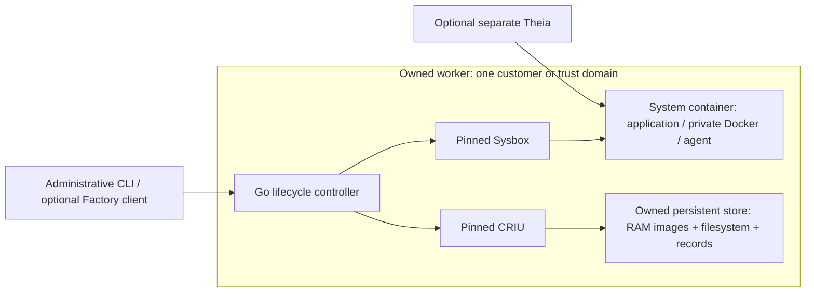

# Factorybox

Factorybox is a standalone Linux system-container runtime with complete RAM and
filesystem checkpoints, independent forks, pause and resume. It combines a Go
lifecycle controller with exactly pinned, patched Sysbox and CRIU components.
An IDE, Dev Container or agent can consume the runtime without becoming a
lifecycle dependency.

Use it to preserve and branch a development environment, including private
Docker state and running agent tools, on infrastructure you operate without
KVM. Factorybox currently requires a privileged worker container and shares
the host kernel. It supplies no VM isolation boundary.

The selected AMD64 release candidate passes its complete twenty-run local
series and operating/storage cases. Production qualification remains open,
including actual-provider acceptance and historical cleanup attribution. Start
with the [current release status](docs/first-release-status.md),
[measured performance](docs/first-release-performance.md) and
[supported worker contract](docs/worker-contract.md). The
[earlier pilot report](docs/pilot-validation.md) is historical evidence.

The first [Kubernetes consumer admission](docs/kubernetes-worker.md) adds native
HTTP readiness and exact worker identity guards. Its real CLI transport proof
passes. The [Factory consumer integration](docs/factory-consumer.md) also passes
native Start, shared-source Pause/Resume and real reserve activation with the
actual Connector. A running Kubernetes cluster is not yet qualified.

## Why use Factorybox

Factorybox is for teams that need complete, branching development environments
on their own Linux workers and can accept system-container isolation. The
tested environment includes private Docker/Compose, Dev Containers and a real
running agent tool. A restored branch retains its process state as well as its
files; restarting an application from a copied directory is a different operation.

The concrete reasons to choose this approach are:

- Run without `/dev/kvm` or nested virtualization, provided the host admits the
  required privileged container, namespace, cgroup, FUSE and mount operations.
  This does not make arbitrary managed container platforms compatible.
- Keep lifecycle code, checkpoint backing and operation records on infrastructure
  you control. The administrative interface does not depend on a vendor control
  plane, IDE or model provider. You also own scheduling, storage and on-call work.
- Inspect and reproduce the exact runtime/component sources, ordered patches
  and binary identities used by the acceptance tests.
- Continue and independently branch the admitted full Docker/agent workload,
  including a previously forked or resumed source, with measured RAM release
  during pause and exact ownership checks during recovery and deletion.

These are deployment and control advantages for that workload. Lower cost,
higher density, stronger isolation and faster startup than managed services
have not been demonstrated. RAM snapshots and forks are also available in
other products; they are not an exclusive Factorybox feature.

## What works

- Checkpoint a running sandbox and restore an independent RAM/filesystem fork.
- Checkpoint and fork an existing fork or a resumed source. A descendant remains
  useful after deleting its original source.
- Pause with measured release of source anonymous RAM and resident snapshot-RAM
  pages, then resume useful application work from the saved state.
- Recover a fully committed pause after planned or abrupt removal of the whole
  worker, using a fresh worker on the same host and the complete persistent store.
- Reject incomplete or corrupt recovery inputs and reconcile exact completed
  requests. Delete only objects whose saved ownership matches.

Both complete examples passed. The [minimal Dev Container](examples/minimal)
preserves application RAM and files. The [Factory composition](examples/factory)
adds private Docker, Compose, Dev Containers, a separate Theia IDE and real
OpenCode. Its active shell tool preserves private RAM and file watches across
fork/resume, produces different branch results and returns its real exit status
to the agent. The original lifecycle proofs use a deterministic local model peer.
A complete lifecycle and planned/abrupt worker replacement now also pass with pinned
OpenCode and a real external free model. Each capture requires the optional
provider gateway to exit; later inference connects through a fresh gateway.
A lost completed model response also recovers without another shell invocation.
Broader cancellation and uncertain external side effects remain release tests.
See the [current evidence](docs/production-progress.md).
Theia remains a separate reconnecting consumer rather than part of sandbox RAM.



## Historical pilot performance

The current release's complete twenty-run measurements are in
[first-release-performance.md](docs/first-release-performance.md). The values
below describe the earlier pilot and its predecessor.

Five observations per configuration and example, interleaved on one host.
Times are medians in seconds. A useful fork starts from an already published
checkpoint; creating a new checkpoint adds its own cost.

| Factory operation | Original v0.1, Docker VFS | Current reference, Docker Overlay2 |
| --- | ---: | ---: |
| Checkpoint | 24.158 | 6.875 |
| Useful fork | 18.044 | 5.995 |
| Pause | 24.165 | 7.593 |
| Useful resume | 8.613 | 2.834 |
| Fresh start with prepared inputs | 33.683 | 33.099 |
| Cold worker, local preparation and useful application | 58.152 | 55.581 |

These historical Factory startup values include a subsequently diagnosed
fixture delay: its authority ignored an immediate `stream-error` and waited
ten seconds if the first app port was not ready. Functional state assertions
remain valid. Both variants are being remeasured with the corrected authority;
removing that measurement delay is not a production runtime speedup. The
[investigation](docs/production-progress.md) also records a separate consumer
patch for an unnecessary feature-catalog fetch. No revised performance
distribution is qualified yet.

The minimal example takes about 2.009 s for a useful fork, 1.870 s to pause and
1.045 s to resume. Its checkpoint after resume regressed from 1.783 s to
2.100 s, within the predeclared 20% allowance. These observations establish
neither p95 nor a stable sub-three-second service level.

The largest demonstrated change is private Docker's storage representation:
about 335 MB and 10,102 entries with Overlay2 instead of 1,362 MB and 31,475
entries with VFS. Ordered CRIU fixes make those nested layers restorable.
Every branch still has independent mutable backing. Removing a duplicate
source payload read gives about 3% in its isolated copy microbenchmark; the
combined lifecycle comparison does not isolate its contribution.

Pause leaves source anonymous memory and resident snapshot-RAM pages at zero.
Worker services, filesystem cache and metadata still consume memory. Full
observations, preparation costs, ranges, failures and memory measurements are
linked from the [acceptance report](docs/pilot-validation.md).

## How it compares

[Battleships](https://battleships.dev/) is a provider comparison and cost
estimator, rather than a sandbox runtime. Its catalogue is useful for finding
alternatives; a feature label or provider benchmark does not establish that
the same workload, memory, Docker state and recovery boundary were tested.

The following comparison uses each project's own documentation, checked on
2026-10-22. No provider was benchmarked against Factorybox here.

| Project | Role and documented capabilities | Difference from Factorybox |
| --- | --- | --- |
| Factorybox | Self-managed system-container lifecycle with the complete admitted RAM/filesystem forks and committed-pause recovery above | Exact local AMD64 scope; administrative CLI; operator supplies workers and storage |
| [Sysbox](https://github.com/nestybox/sysbox) | A specialized runc for system containers running Docker, systemd and other system software | Factorybox builds on its isolation and virtualization, adding lifecycle records, complete independent snapshots, pause memory accounting and verified recovery |
| [Daytona](https://www.daytona.io/docs/en/linux-sandboxes/) | Offers container sandboxes sharing the host kernel and Linux VM sandboxes with their own kernel; VM persistence includes memory-preserving pause/resume and forks | Factorybox provides its own host-kernel runtime and local control contract. Daytona's VM and container modes need separate comparison; its container mode does not support pause |
| [Modal](https://modal.com/blog/vm-sandboxes-agent-computers) | Offers its original gVisor runtime and a Cloud Hypervisor-based VM runtime, including Docker workloads | Factorybox avoids a guest VM and supplies a self-managed lifecycle. Modal supplies managed infrastructure; its [memory snapshot documentation](https://modal.com/docs/guide/sandbox-snapshots) currently marks that feature Alpha |

### KVM and the isolation tradeoff

[Firecracker](https://github.com/firecracker-microvm/firecracker/blob/main/docs/design.md)
uses KVM-backed microVMs with guest kernels. That adds a VM boundary between
workload and host. Factorybox uses host-kernel system containers and requires
no hypervisor. This can matter when KVM is unavailable or managing a guest OS
is undesirable, but it is not proof of better latency, density or security.
Daytona also offers containers, and Modal offers both gVisor and VMs; treating
all managed sandboxes as one KVM architecture would be incorrect.

The initial Factorybox trust boundary is separate workers per customer or
trust domain. Two workers on one host still share that host's kernel. Workloads
requiring a VM boundary should use an appropriate VM deployment or alternative;
that deployment is not qualified by this repository.

### How the performance numbers compare

| Published or measured endpoint | Reported time | What it establishes |
| --- | ---: | --- |
| Factorybox minimal, cold worker through useful application | 33.029 s | Local median including preparation and application initialization |
| Factorybox complete Factory example, same endpoint | 55.581 s | Historical local median; includes the subsequently diagnosed fixture delay described above |
| Factorybox useful resume, minimal / Factory | 1.045 s / 2.834 s | Local medians for our admitted application state, from five observations each |
| [Daytona environment creation](https://www.daytona.io/dotfiles/daytona-joins-the-ai-engineer-pack) | 200 ms | Provider claim published 2025-03-24; no equivalent Factorybox workload or percentile in that article |
| [Modal VM cold start](https://modal.com/blog/vm-sandboxes-agent-computers) | Under 1 s | Provider claim published 2026-10-01; not a measurement of our complete application or its memory restore |

Factorybox has not established a performance lead. Provider provisioning
figures describe an earlier or differently defined endpoint than our complete
application measurements; they cannot support a speed ratio in either direction.
We also lack a matched provider result for restoring this RAM/private-Docker
state. The earlier table demonstrates improvement over Factorybox v0.1 only.

A valid comparison must run the same minimal and Factory consumers, pinned
images, active tool and Docker data on each product. Report provisioning,
preparation, first useful work, checkpoint, fork, pause, resume, retained memory,
storage and cost separately. Record resource allocations, region/network,
warm/cold cache state, failures and sample counts. An unsupported workload is
a compatibility result. An unmeasured operation remains unknown, never zero.

Sysbox and Factorybox share the host kernel. Neither this implementation nor
its tests establish VM isolation. Deploy separate workers per customer or
trust domain. Factorybox has its own CLI and versioned JSON contract; Sysbox
CLI/OCI feature parity and arbitrary Sysbox workload compatibility are not
promised. The tested Factory workload is the acceptance boundary.

### Where Kubernetes fits

[Kubernetes](https://kubernetes.io/docs/concepts/overview/) provides worker
placement, storage orchestration, rollouts and service management. Those are
useful reasons to integrate Factorybox into an existing cluster. They do not
make its checkpoint or resume faster, or supply application RAM recovery.

This repository qualifies a Docker worker and local persistent volume. It
does not yet qualify a Kubernetes operator, arbitrary Kubernetes nodes or a
PVC/storage backend. A future deployment must qualify the exact node kernel,
privileges, cgroups, storage and fencing. A paused sandbox would need its
complete owned store on that qualified storage, including filesystem backing,
RAM images and operation records. A pod restart or a movable PVC alone does
not establish restore on another node. Cross-node migration is outside this pilot.

## What changed in Sysbox and CRIU

The [source lock](upstream/lock.json) records archive hashes, ordered patches,
imported overlays, prepared-file hashes and fixture compatibility declarations.
The [pilot profile](upstream/amd64-pilot-profile.json) adds the selected CRIU
patches, actual binary identities and evidence hashes. No upstream version
floats at build time.

| Component | Pinned source commit |
| --- | --- |
| [Sysbox runc](https://github.com/nestybox/sysbox-runc) | `081856cc5d17e7095f066b08d0eca6bb0b515c47` |
| [Sysbox fs](https://github.com/nestybox/sysbox-fs) | `c3d2ebc65102e32e74e383675f03b45556326888` |
| [Sysbox mgr](https://github.com/nestybox/sysbox-mgr) | `2d45af01bcfd8641e6641f76104c6003bf501cd7` |
| [CRIU source fork](https://github.com/castai/criu) | `086df34a2da27125fa05e66ba4d6b63cbb220b2e` |

The lock also pins Sysbox ipc, libs, fuse and upstream tests. These are the
actual changes, rather than a claim that the components run unmodified:

- Sysbox patches and retained overlays capture/restore virtual filesystem
  state, preserve registration and namespace lifetime, reconstruct rootfs,
  seccomp listeners and cgroup delegation, and issue restore receipts.
  The manager can disable unqualified binfmt_misc handling. Restored overlays
  use a mount-local `index=off` setting.
- The base CRIU patch stack handles the admitted nested namespaces, detached
  proc roots/descriptors, time namespaces, cgroup-v2 limits and zombie PIDs.
  Five additional retained-context/exit-observer patches protect original
  source state during the evidenced capture failures. Three nested-overlay
  patches preserve layer mappings, stable paths and shared upper/work mounts.
- The Go runtime owns intent/completion records, component and object identity,
  filesystem admission/copy verification, memory release, recovery and deletion.
  Bounded inotify fallback roots are an explicit OCI annotation.

Each selected change has regression evidence. The immutable imported reference
and overlays retain their original bytes; later changes are ordered patches.
Candidate filenames are historical provenance, not automatic selection.
SHM, lazy/delta snapshots and read-hint experiments are excluded from the
selected path. [Investigation notes](docs/pilot-progress.md) retain the limits
and failed approaches.

## Build and integrate

Only the evidenced Linux AMD64 tuple is qualified for this pilot: kernel
`7.2.8-9-omarchy`, 4096-byte pages, cgroup v2 and the tested Docker/local-volume
path. `factorybox doctor` checks the tuple; it does not replace native tests.
Cross-compilation does not qualify another machine.

The repository pins Go and Python through mise. Run portable checks first:

Portable checks use Go's host build constraints. Linux-only descriptor-store,
source-actor and consumer checks run on Linux and are reported as unavailable
on other hosts. Their native assertions remain unchanged; a passing macOS
check does not qualify a Linux worker or enable ARM64 runtime execution.

```sh
mise exec -- python3 tools/check.py
mise exec -- python3 tools/sources.py prepare
mise exec -- python3 tools/sources.py verify
```

Build the native base and Sysbox, then the selected CRIU composition and worker:

```sh
mise exec -- python3 tools/build_native_base.py --platform linux/amd64
mise exec -- python3 tools/build_sysbox.py --platform linux/amd64 --network host \
  --builder "$builder" --bounded-build
mise exec -- python3 tests/criu-retained-candidate/build.py \
  --native-base-build "$base_build" --exit-hold --exit-hold-socket \
  --nested-overlay --nested-overlay-stable-paths --nested-overlay-shared-root
mise exec -- python3 tools/build_worker.py \
  --platform linux/amd64 \
  --native-base-build "$base_build" --sysbox-build "$sysbox_build" \
  --retained-candidate "$criu_build"
```

Set the variables to the exact successful artifact names printed by the
preceding builds. On the tested host the Docker tools use
`FACTORYBOX_DOCKER_CONTEXT=default FACTORYBOX_DOCKER_ELEVATION=sudo`.
These commands build local containers and install no host runtime.
Independent offline rebuilds reproduced all three Sysbox executables, CRIU,
the complete worker package and image. They reuse verified toolchains and
dependency inputs; future network/package availability is a separate concern.

For a bounded Sysbox build, `$builder` must name a running, single-node Buildx
`docker-container` builder. The build checks its actual container's memory
and CPU quotas before compilation. Buildx does not support the previously
used `build --resource` flags. Create a uniquely named builder without
changing your default:

```sh
builder="factorybox-build-$(uuidgen | tr '[:upper:]' '[:lower:]')"
docker --context orbstack buildx create --name "$builder" \
  --driver docker-container \
  --driver-opt 'image=moby/buildkit@sha256:cec9f139f45e93c5c69c60f8b07cfad9f43f4ef6b6a6cd917527fea5ff2e3dea,memory=3g,cpu-period=100000,cpu-quota=300000,network=host' \
  --buildkitd-flags '--allow-insecure-entitlement network.host' orbstack
docker --context orbstack buildx inspect --bootstrap "$builder"
```

The local worker pipeline accepts either `linux/arm64` or `linux/amd64`.
Supply an exact successful native-base build for that same target. It builds
Sysbox, the retained-context/nested-overlay CRIU composition, then the worker
image and a losslessly compressed package:

```sh
mise exec -- python3 tools/build_worker_pipeline.py \
  --platform linux/arm64 --native-base-build "$base_build" \
  --builder "$builder" --bounded-build --network host
```

Use `--sysbox-build` and `--retained-candidate` to reuse exact verified completed
inputs, never an inferred latest build. The worker checks the ELF architecture
of every executable, component platform agreement and the final image platform.
Its receipt records the image and Factorybox executable digest. There is no
push, installation or automatic runtime admission.

ARM64 component and worker builds are supported, but the current runtime still
rejects ARM64 execution. The owned timer reader runs natively on ARM64, using
the iterator's referenced BTF layouts and an inline PID filter without kernel
maps. The ARM64 timer CPU backend also passes native staged/native-wait
register, stack and signal-mask handoff checks. Complete guarded lifecycle,
recovery and consumer qualification remain required. A successful build does not
remove that guard or qualify the target kernel.

Run the timer-reader prerequisite against an exact native base for the target:

```sh
mise exec -- python3 tools/timerstate_native.py \
  --platform linux/arm64 --native-base-build "$base_build"
```

It verifies the real relative deadline, PID/birth ownership, refusal of a wrong
birth and removal of its temporary BPF program. It does not admit the platform,
test RAM checkpoint/restore, or replace the required lifecycle/consumer suites.

The separate CPU prerequisite executes the real ARM64 private code and confirms
X1-X30, SP, NZCV, unchanged request/stack bytes, native deadline activation and
original context on recapture:

```sh
mise exec -- python3 tools/timer_arm64_native.py --native-base-build "$base_build"
```

Explicit lifecycle candidates link only their selected architecture and the
actual native Docker kernel. `--candidate-platform linux/arm64` is available to
the native lifecycle runner; it does not change ordinary worker admission.

To test a delivered worker image before platform admission, pass
`--native-candidate` to `tools/build_worker.py` with the exact component inputs
above. It requires a matching native Linux Docker host and links only that host's
kernel. The bundle and build receipt retain this unqualified candidate identity.
It is not a release image and does not change ordinary builds or select a worker
for Factory.

The bounded-store proof can execute that exact delivered candidate, retaining
the original ENOSPC, independent RAM, checkpoint/fork and pause/resume assertions:

```sh
mise exec -- python3 tools/bounded_store_native.py \
  --worker-build "$worker_build" --native-candidate --suite capacity
```

The runner requires the delivered candidate's exact native kernel and observes
the fixed global sysctl set on the Docker host, not on macOS. An absent kernel
interface remains explicitly absent in both observations, as in the original
global observer. This isolated proof does not qualify the remaining timer,
worker-recovery or consumer suites.

The same runner has explicit `restore-hold`, `timer-state-reader`,
`timer-exit-guard` and `timer-detach` suites for either native architecture.
They retain the original five sealed restore/resume acknowledgement cases,
bulk and non-leader timer reads with an independent Python comparison, actual
normal/SIGKILL tracer exit and 256 real detach completions under owned CPU
pressure. Every original assertion and refusal control remains in those
fixtures. Their ARM64 passes do not replace the remaining interrupted-timer,
recovery or Factory consumer qualification.

Use the [worker integration example](examples/worker/README.md) for the exact
Compose deployment, store ownership, readiness and administrative workflow.
The worker needs privileged container access and owns one persistent store.
It exposes no network API. The tested worker ceiling is 3 CPU/3 GiB with at
most two live sandboxes; separate Theia has 1 CPU/768 MiB. Complete native
lifecycle runs retain the 420-second deadline.

The [minimal](examples/minimal/.devcontainer/devcontainer.json) and
[Factory](examples/factory/.devcontainer/devcontainer.json) examples remain
acceptance consumers. Application installation, private Docker startup, image
imports and application readiness belong to those consumers.

## Tests, evidence and remaining work

The pilot includes fourteen native runtime suites, eighteen unchanged CRIU
core cases with two checkpoint/restore cycles each, Sysbox unit/core/integration
and lifecycle/systemd suites, active OpenCode tests, complete worker-loss
cases and the matched comparison. The upstream skip sets are explicit in the
[original AMD64 report](docs/amd64-validation.md). Required failures or unrun
suites block production qualification; passing a smaller selection does not
waive them. Vet stays enabled.

`tools/verify_pilot_profile.py` rechecks all 44 selected gates, the current Go
source against the reproduced worker, actual delivered executable bytes,
source/fixture integrity and all twenty raw observations. It requires the
retained local artifacts and images. `artifacts/` and `.cache/` are ignored by
Git; cloning this repository does not download native proof payloads or images.
The [worker contract](docs/worker-contract.md) describes reproducible builds,
API schemas, storage, retries and exact recovery inputs. The
[original bundle guide](docs/runtime-bundle.md) preserves v0.1 reconstruction.

The next concrete performance work is profiling the roughly 33-second Factory
application initialization and the full immutable-base import on fresh-worker
recovery. Existing verified-base reuse already makes additional fresh bundle
preparation about 64–67 ms in individual functional proofs, but application
startup still costs about 32 seconds. One complete Compose recovery spent
15.731 seconds importing/restoring, including a full 1.78-GB base. Reuse across
worker epochs would need new identity, fencing and independence proofs.
Neither investigation has a demonstrated additional speedup yet.

## Path to the first production release

The first release should qualify one concrete operating environment: our
Factory workload on owned Linux AMD64 workers, one kernel/storage profile,
separate workers per trust domain, at most two live sandboxes and the existing
resource ceilings. The initial recovery contract remains same-host,
same-boot recovery of a fully committed pause. More architectures, Kubernetes,
cross-node migration and host-reboot RAM recovery are separate expansions.
Supporting every deployment is not a prerequisite for this first release.

The [accepted local goal](GOAL.md) works through these release gates. They are
not completed work or an availability/latency promise:

| Gate | Work and exit evidence |
| --- | --- |
| Exact deployment and supported workloads | Qualify the existing Linux AMD64 host, exact kernel/storage/consumer inputs and delivered image. Keep unsupported features rejected before state changes. Another production node needs its own qualification; the current admission must not be loosened to admit an untested node |
| Required upstream and failure coverage | Preserve all upstream assertions. Resolve every required failed/unrun test for the chosen contract. Explicitly unsupported capabilities remain excluded and their original skips remain visible; no required skip becomes a pass by reclassification. Cover earlier controller/guard-loss windows if those are in the release contract |
| Repeated operation and failure behavior | Diagnose the preserved filesystem-service startup timeout. Proposed initial evidence is at least 100 complete lifecycles per consumer plus a bounded 24-hour soak, with interruption, memory/storage pressure and exact replay. Require zero integrity/ownership violations and no untriaged failures. Native runners must retain their storage guards and resource ceilings |
| Real external agent continuation | Test a real model endpoint and tool workflow through pause/resume, disconnection and worker replacement. Verify reconnect, cancellation and side-effect handling. An uncertain external tool result must be reconciled rather than blindly replayed |
| Durable storage lifecycle | The candidate has filesystem-capacity admission and native rollback proofs for actual copy ENOSPC and capture-worker death with zero free snapshot space, covering checkpoint and pause. Hard store quotas, broader pressure cases and ownership-checked checkpoint/old-epoch retirement remain open. Prove no required snapshot or live descendant loses backing. Sandbox deletion retains checkpoint/operation files and does not provide automatic store garbage collection |
| Operable release package | Produce a minimal runtime image with component/dependency inventory and license notices; repeat required tests on its actual bytes. Define metrics, alerts, timeouts, fencing, incomplete-operation reconciliation, drain and rollback procedures. An upgrade may not silently reinterpret old snapshots; qualify compatibility or drain the old format first |
| Security, distribution and acceptance | Review the privileged worker and host-kernel trust model, secret access and dependency update process. Resolve original-code licensing before a distributable release. Agree error/latency and host-loss behavior for this service, then verify those expectations from a larger measured sample |

Once the gates pass, a new production profile can bind the exact sources,
patches, binaries, platform and results. Keep the current reference immutable.
Performance improvements must pass the same integrity, recovery and upstream
checks; faster startup alone cannot provide production qualification.

Current work covers storage retention/capacity, the unresolved startup and
restore failures, repeated operation and the final worker package. Complete
external-agent lifecycle and same-host worker-replacement proofs are recorded
in [production progress](docs/production-progress.md), with their failure limits.
Prepared-base reuse and the fixed comparison of consumer startup remain
unselected until their full acceptance passes. The earlier 33-second startup
included a corrected test-peer timeout; it is not a clean runtime baseline.

The original-code distribution license remains unresolved; this repository
grants no new license by implication. Pinned upstream notices remain under
[upstream/licenses](upstream/licenses), with their identities carried into
built packages.

Recovery covers a fully committed pause on the same host and boot with intact
owned storage. Unsaved running RAM, host reboot, host/disk loss, arbitrary TTY
or exec topologies and cross-node migration remain outside the contract.
