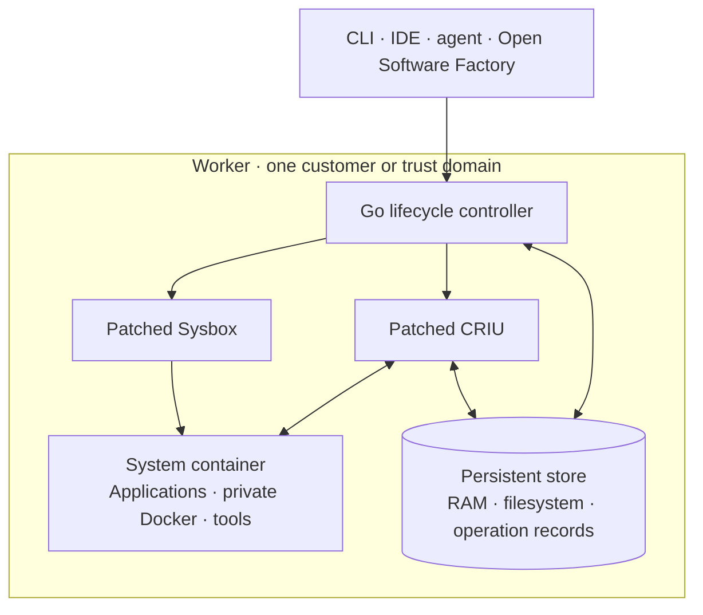

<div align="center">

# Factorybox

**Pause a development environment. Resume where its processes left off.**

A Linux system-container runtime that checkpoints a running environment, RAM included,
and brings it back in seconds. Built on pinned, patched [Sysbox](https://github.com/nestybox/sysbox)
and [CRIU](https://criu.org). It runs on ordinary Kubernetes nodes and needs no hardware virtualization.

[](LICENSE)
[](https://github.com/maxcodefaster/factorybox/tags)
[](#status)

[Why](#why) · [What it does](#what-it-does) · [Compared with](#compared-with-other-isolation) · [How it works](#how-it-works) · [Status](#status) · [Build](#build-and-check)

</div>

---

## Why

A development environment is more than files. It is running servers, a private Docker daemon, half-finished
work and warm caches. Coding agents and people both need that whole state, and they need it to stop costing
money and memory when nobody is looking.

Factorybox treats that state as the thing to keep. Pause an environment and its RAM goes back to the node.
Resume it and the same processes continue, not a fresh boot that rebuilds everything. Fork it and you get an
independent copy with its own memory and filesystem.

[Open Software Factory](https://github.com/maxcodefaster/open-software-factory) uses Factorybox as its
execution layer. Editors, Dev Containers and other agents can connect as consumers too, because the runtime
has no IDE or agent dependency.

## What it does

- **Checkpoint and fork.** Create an independent environment with its own memory and mutable filesystem,
  then branch it again.
- **Pause and resume.** Save the running state, release the Sandbox's anonymous RAM and continue from that
  state. Ten warm cycles on an amd64 node measured a 4.07-second median pause and a 2.99-second
  median resume to a healthy App response, with state preserved in every cycle.
- **Recover a committed pause.** Replace a worker on the same host and recover from its intact persistent
  store and verified operation records.
- **A real machine inside.** Each Sandbox is a system container with its own Docker daemon, without a
  privileged container.

## Compared with other isolation

| | Plain container | gVisor | MicroVM (Firecracker, Kata) | **Factorybox** |
| --- | --- | --- | --- | --- |
| Kernel | Shared with the node | Userspace kernel | Own guest kernel | Shared with the node |
| Docker daemon inside | Suitable privileges or rootless Docker | Depends on runtime support | Guest Docker | Yes, private per Sandbox |
| Pause with memory | Requires checkpoint tooling | Checkpoint support | Depends on runtime | Yes |
| Needs hardware virtualization | No | No | Yes | No |
| Node requirement | Container runtime | Configured sandbox runtime | Virtualization and runtime | Linux capabilities and privileged worker |
| Trust boundary | Shared kernel | Userspace kernel intercepts system calls | Separate guest kernel | User namespaces; shared kernel |

And compared with Sysbox alone: Sysbox is the system-container foundation. Factorybox adds the lifecycle
that preserves and branches a running environment.

| | Sysbox | Factorybox |
| --- | --- | --- |
| Focus | Run system software such as Docker and systemd inside containers | Save, branch, pause and restore complete environments |
| Components | OCI runtime, filesystem service and manager | Patched Sysbox, patched CRIU and a Go lifecycle controller |
| State | Container execution | RAM and filesystem checkpoints, forks, durable operation records, guarded recovery |

The trade is stated plainly. The worker runs as a privileged container and shares the node's kernel, so a
kernel bug is a node bug. Keep one worker per customer or trust domain, run it on its own node pool, and
read the node hardening notes in the Open Software Factory chart README.

## How it works



The Go controller records operation intent, completion and resource ownership, so an interrupted pause or
delete is recoverable and never half-forgotten. Component versions, source hashes and ordered patches are
pinned in the [source lock](upstream/lock.json). Nothing floats at build time.

| Component | Pinned source commit |
| --- | --- |
| [Sysbox runc](https://github.com/nestybox/sysbox-runc) | `081856cc5d17e7095f066b08d0eca6bb0b515c47` |
| [Sysbox fs](https://github.com/nestybox/sysbox-fs) | `c3d2ebc65102e32e74e383675f03b45556326888` |
| [Sysbox mgr](https://github.com/nestybox/sysbox-mgr) | `2d45af01bcfd8641e6641f76104c6003bf501cd7` |
| [CRIU source fork](https://github.com/castai/criu) | `086df34a2da27125fa05e66ba4d6b63cbb220b2e` |

What the patches change:

- Sysbox captures and restores virtual filesystem state, keeps registration and namespace lifetime,
  rebuilds rootfs, seccomp listeners and cgroup delegation, and issues restore receipts.
- CRIU handles the nested namespaces, detached proc roots, time namespaces, cgroup v2 limits and zombie
  PIDs of Docker-in-container, protects the original source state when a capture fails, and preserves layer
  mappings for nested OverlayFS restores. A retry of `openat2` on `EAGAIN` fixes a race when pinning
  overlay layers during restore.

Each change has regression evidence, and the imported upstream tests keep their assertions.

## Status

`v0.1.0-beta.1` is the first public beta, with signed workers for Linux arm64 and amd64.
Each released worker is tied to its image digest and executable hash.

The worker needs only what a standard Linux Kubernetes node offers. It admits any Linux kernel with the
required capabilities (cgroup v2, 4 KiB pages, the checkpoint and restore facilities) and names a missing
capability in its own report. Cross-node migration is not supported.

The signed worker image is `ghcr.io/maxcodefaster/factorybox-worker`. The Open Software Factory chart pins
its image and executable hash, with a separate values file for amd64. Its signature verifies with the
public key in that repository.

The [measurement and samples](https://github.com/maxcodefaster/open-software-factory/blob/main/assets/story/lifecycle.json)
cover two Node containers, a volume and 256 MiB of random application memory. The worker had a 3-CPU /
3-GiB limit on a Ryzen 7 4800U Linux node with k3s. Times include Kubernetes transport, and resume ends on
an App state probe. These warm restores are not cold-start times or a provider benchmark ranking.

## Build and check

With [mise](https://mise.jdx.dev) installed, run the portable checks:

```sh
git clone https://github.com/maxcodefaster/factorybox.git
cd factorybox
mise trust && mise install
mise exec -- python3 tools/check.py
```

Native builds run on a Linux host with Docker, and native qualification runs on a node you admit. The build
and conformance commands are driven from the Open Software Factory repository (`bun run factorybox:build`,
`bun run runtime:conformance` and `bun run factorybox:publish`).

Report bugs as GitHub issues and vulnerabilities as described in [SECURITY.md](SECURITY.md).

## License

Original Factorybox code is [Apache-2.0](LICENSE). Sysbox, CRIU and their dependencies keep their original
licenses and notices. See [LICENSING.md](LICENSING.md) and [NOTICE](NOTICE) for component and distribution terms.
